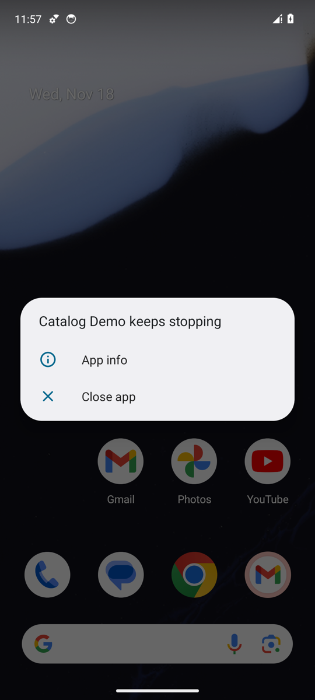
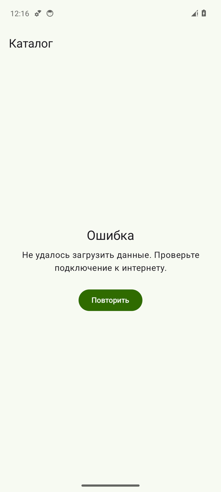
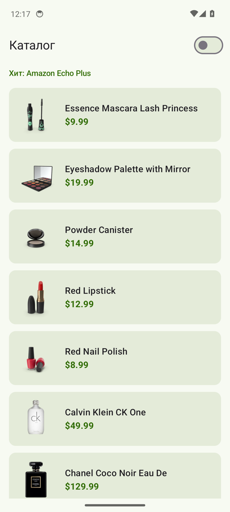
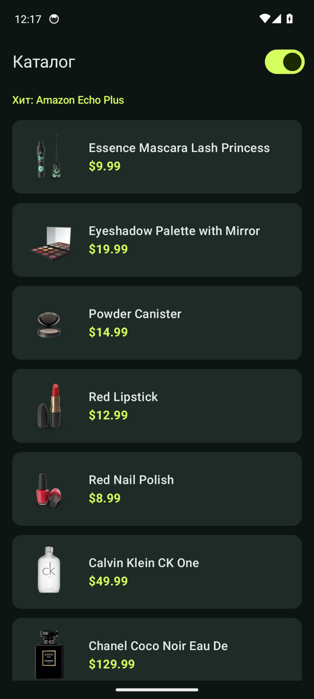
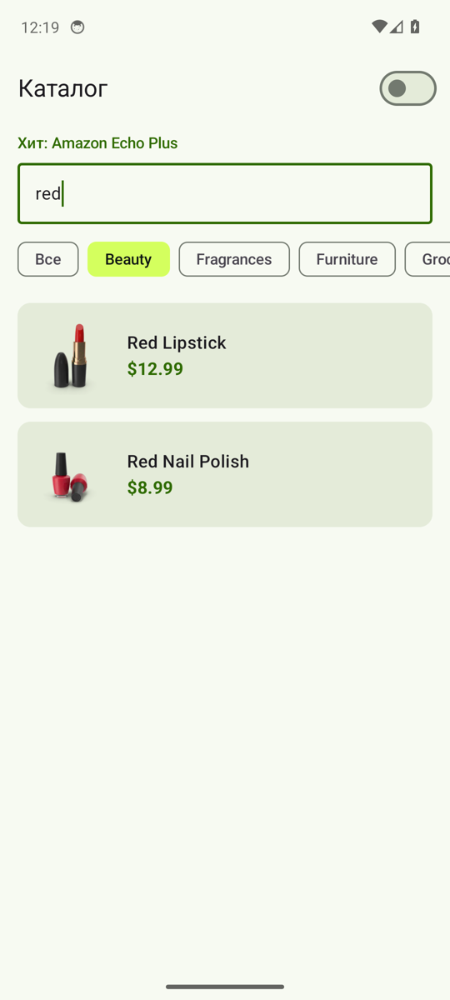
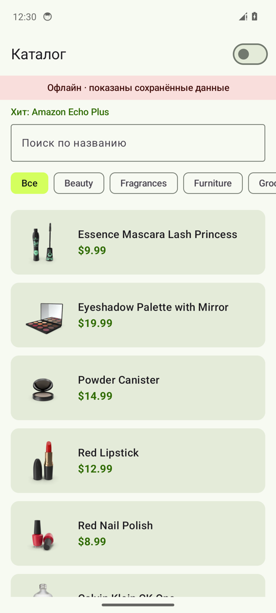
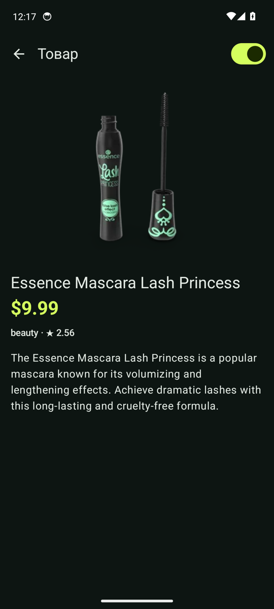

# Catalog Demo

[](https://github.com/Garjelin/KWORK/actions/workflows/ci.yml)

Демо-проект: небольшое Android-приложение «Каталог товаров» на Kotlin и Jetpack Compose.
Данные берутся из открытого API [dummyjson.com](https://dummyjson.com/products) (ключ не нужен).
Два экрана: список товаров (картинка, название, цена) и карточка товара.

Проект собран как набор небольших, самостоятельных доработок. Каждая сделана в отдельном pull request:

| # | Работа | Что внутри |
|---|--------|------------|
| 1 | Исправление падения | Приложение падало при ошибке сети и пустом ответе. Теперь показывается экран ошибки с кнопкой «Повторить» |
| 2 | Тёмная тема | Переключатель в верхней панели, светлая и тёмная темы Material 3 |
| 3 | Поиск и фильтр | Поиск по названию и фильтр по категории на экране списка |
| 4 | Офлайн-режим | Кэш в Room: без интернета список открывается из кэша, сверху плашка «Офлайн» |
| 5 | Автотесты и CI | UI-тесты на Kaspresso с Page Object, GitHub Actions: сборка, unit-тесты, UI-тесты на эмуляторе |

## Скриншоты

| Падение (до) | Экран ошибки (после) | Светлая тема | Тёмная тема |
|:---:|:---:|:---:|:---:|
|  |  |  |  |

| Поиск и категория | Офлайн-режим | Карточка (тёмная) |
|:---:|:---:|:---:|
|  |  |  |

## Стек

Kotlin, Jetpack Compose, Material 3, ViewModel + репозиторий (простой MVVM), Navigation Compose,
Retrofit + kotlinx.serialization, Room, Coroutines/Flow, Coil, Kaspresso, GitHub Actions.
`minSdk 24`, `targetSdk 36`. Один модуль, без DI-фреймворков.

## Как запустить

```bash
./gradlew installDebug          # собрать и поставить на эмулятор или устройство
./gradlew assembleDebug         # только собрать APK: app/build/outputs/apk/debug/
```

## Как запустить тесты

```bash
./gradlew testDebugUnitTest          # unit-тесты (ViewModel, репозиторий, фильтрация)
./gradlew connectedDebugAndroidTest  # UI-тесты Kaspresso, нужен запущенный эмулятор или устройство
```

UI-тесты не ходят в сеть: репозиторий подменяется фейком, поэтому они стабильны.
Page Object лежат в `app/src/androidTest/java/com/demo/catalog/screens/`.

## Структура

```
app/src/main/java/com/demo/catalog/
  data/   Retrofit API, Room (кэш), репозиторий
  ui/     экраны Compose, ViewModel, тема
app/src/test/        unit-тесты
app/src/androidTest/ UI-тесты Kaspresso + Page Object
```
